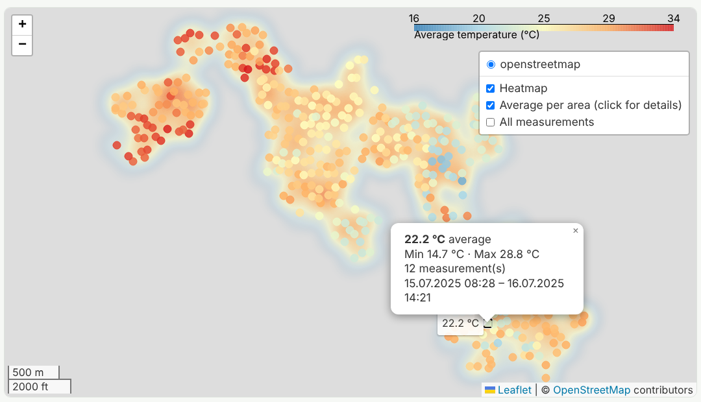

# Cool Heilbronn – Urban Heat Map

Green City Hackathon 2026 · Topic: Climate Change – Mitigation (Green Capital Heilbronn)

A Flask website that shows where Heilbronn heats up: a temperature heatmap, a discomfort-index
(DI) map, the analysis of what explains the temperature differences, and proposed solutions
against urban heat.



## Run it locally

```bash
pip install -r requirements.txt
python app.py
```

Open http://127.0.0.1:5000

| Page | URL |
| --- | --- |
| Home (key numbers) | `/` |
| Heatmap (with time filter) | `/map` |
| Data Analysis | `/analysis` |
| Proposed Solutions (with DI map) | `/solutions` |
| Temperature map only (used inside `/map`) | `/map/view` |
| Discomfort Index map only (used inside `/solutions`) | `/solutions/di-map` |

## Data

### Data files

| File | Content |
| --- | --- |
| `data/alles_kid_temp_clean.csv` | Walking sensors (senseBox, up to ~8 devices), 61,410 readings, 1–3 Sept 2026 (about 10:30–14:20 local time). |
| `data/OSEM_Bike_Data_cleaned.csv` | openSenseMap bike sensor, 54,979 readings, 5 Aug–14 Sep 2026, temperature and humidity about every 5 s. 48,848 readings lie inside the Heilbronn area used by the maps. |
| `data/sample_temperature.csv` | **Invented** Day 1 sample (`scripts/make_sample_data.py`). Used only if both real files are missing. |
| `data/computed/` | The calculated values behind the temperature map (ΔT per measurement, per ride and per map cell). Created by `scripts/export_delta_t.py`. |

Both real files are loaded together, so the maps use **110,258 measurements** (shown in the box at
the bottom right of each map).

### Columns the code understands

| Column | Example | Meaning |
| --- | --- | --- |
| `timestamp` | `2026-09-02T08:29:09Z` | Time of measurement (ISO 8601) |
| `latitude` | `49.1427` | WGS84 latitude |
| `longitude` | `9.2185` | WGS84 longitude |
| `temperature_c` | `28.4` | Air temperature in °C |
| `humidity` | `52.0` | Relative humidity in % (only needed for the DI map) |

Other column names are renamed automatically when the CSV is loaded (`createdAt`, `Temperature`,
`Rel. Humidity`, `lat`, `lon`, `temp`, …). All other columns are dropped. The loader also:

- converts times to Heilbronn local time (Europe/Berlin); times without a time zone (the bike
  data) are assumed to be UTC, as in the analysis report,
- keeps only points inside the Heilbronn area (latitude 49.08–49.20, longitude 9.13–9.30) and
  temperatures between −40 and 60 °C,
- adds the file name as `source`.

To use other file(s) (separate several files with `:` on macOS/Linux, `;` on Windows):

```bash
DATA_CSV=data/a.csv:data/b.csv python app.py
```

## How the maps work

### Temperature map (ΔT)

The measurements were recorded on different days and at different times, so raw temperatures would
mostly show *when* someone measured, not *where* it is hot. The map therefore compares every
measurement with the expected temperature of its own ride:

1. **Split into rides.** A gap of more than 30 minutes starts a new ride (145 rides).
2. **Expected temperature of a ride.** For rides of 30 minutes or less it is the ride's average.
   For longer rides it is a straight-line time trend, which removes the normal warming or cooling
   of the air during a long ride.
3. **ΔT = measured temperature − expected temperature.** ΔT > 0 means hotter than normal for that
   ride at that moment.
4. **Average per grid cell** of about 110 m × 75 m (0.001°), so a place that was passed many times
   does not look hotter just because it has more points.
5. **Colours** go from blue (cooler) through white (0) to red (hotter). The scale is ± the 95th
   percentile of the cell values, so a few outliers do not wash out the colours.

Layers (toggle top right): **Hotspots** (smooth glow where ΔT > 0), **ΔT per area** (click a dot
for ΔT, measured average, number of measurements and rides, time range) and a thinned-out
**sample of single points** (display only, off by default).

Export the map as a standalone HTML file: `python -m viz.heatmap` (writes `static/maps/heatmap.html`).
Export the calculated numbers as CSV: `python scripts/export_delta_t.py`.
`/map?start=...&end=...` filters by time (the form on the page sets these).

### Discomfort Index map

The Discomfort Index describes how the heat *feels*. It uses temperature **and** humidity:

```
DI = 0.81 · T + 0.01 · RH · (0.99 · T − 14.3) + 46.3        (T in °C, RH in %)
```

| DI | Meaning |
| --- | --- |
| below 75 | comfortable |
| 75 to below 80 | slightly unpleasant |
| 80 and above | high alert |

It uses the same measurements and the same grid cells as the temperature map, so both maps show
dots at the same places. Layers: **DI heatmap** (only areas with DI ≥ 75), **DI per area**,
**only DI ≥ 80**, **only DI 75–80**. Road-surface layers appear automatically if the data has
`Surface Asphalt / Compacted / Paving / Sett` columns (the current files do not).

`python -m viz.di_map` writes `static/maps/heat_index_map.html`.

### Map and analysis report use different methods

| | Maps (this section) | Analysis report (`docs/analysis_2.pdf`) |
| --- | --- | --- |
| Trip / ride split | gap > 30 min | gap > 5 min |
| Expected temperature | average (≤ 30 min) or time trend (> 30 min) | straight-line time trend |
| Walking sensors | all readings, one ride per recording | only the 2 Sept walk; each device track cut into 10-minute pieces |
| Grid cell | about 110 m × 75 m | 100 m |
| Cells shown | every cell with data | only cells visited on at least 2 trips |
| Unit | ΔT in °C | anomaly in K |

The maps are for visual exploration. **The numbers in the findings below come from the analysis
report**, which is the stricter method.

Known limits of the maps:

- ΔT is relative to each ride, not absolute. A ride that stays in one district shows no difference.
- Within one ride, time and place change together, so the hotspot ranking depends on how the
  expected temperature is calculated. Treat the hotspots as candidates.
- The walking-sensor data has no device ID, and sensors walking side by side read 1–2 K apart
  (see the report). The maps do not separate the devices, so ΔT from the walking data can reflect
  which device walked where.

## Analysis: what explains the temperature differences?

Full report: [`docs/analysis_2.pdf`](docs/analysis_2.pdf) (Oct 28, 2026)

### Key findings

Three factors explain most of the temperature differences in our measurements: industrial land
north of the centre, open land and river corridors on the edges, and tree canopy. All differences
are small in absolute terms (tenths of a kelvin), because they are measured within one trip, but
they are statistically clear and match the city's own 2017 climate analysis.

1. **Industrial north is warmest, open land in the south-west is coolest.** Bike cells in the
   industrial corridor between the centre and the sewage works averaged +0.18 K; cells south-west
   of the centre (Neckar meadows, open land) averaged −0.13 K. In the evening the gap widens to
   0.52 K (+0.33 K vs −0.19 K).
2. **The edge of the city cools first in the evening.** Controlling for tree cover, every km from
   the centre lowers the anomaly by 0.10 K in the evening (95% CI 0.07–0.13), but only by 0.02 K
   at midday. Cells 5–8 km out were 0.29 K cooler in the evening.
3. **More tree canopy means cooler, more humid air.** Each extra 10% of crown cover within 100 m
   lowers the anomaly by 0.07 K (95% CI 0.04–0.10) and raises relative humidity by 0.4 %-points.
   The effect holds in the morning, at midday and in the evening, and inside the urban core alone.

A methodological finding for anyone using the walking-sensor data: sensors walking side by side
read 1–2 K apart, so raw comparisons between devices are not valid.

### Data and method

| Dataset | What it contains | Used in the analysis |
| --- | --- | --- |
| Bike sensor (`OSEM_Bike_Data_cleaned.csv`) | 54,979 readings, 5 Aug–14 Sep 2026, temperature and humidity every ~5 s | 49,686 readings in 174 trips inside Heilbronn |
| Walking sensors (`alles_kid_temp_clean.csv`) | 61,410 readings from up to ~8 devices, 1–3 Sep 2026 | 36,368 readings from the 2 Sep city walk |
| Baumkataster Heilbronn 2026 | 43,031 city-registered trees with crown diameter (dl-de/by-2.0) | Tree-crown cover around each cell |
| Gesamtstädtische Klimaanalyse 2017 | Official climate stations (2015/16), climatope map | Centre point and station comparison |

The analysis compares each measurement with the rest of its own trip, so weather and time of day
cancel out and only place-to-place differences remain.

- **Removing weather and time of day.** Each bike trip was split at gaps over 5 minutes, and a
  straight-line time trend was removed from each trip. This is the same correction the city's
  climate analysis applied to its e-bike runs. The result is an anomaly in kelvin: how much warmer
  or cooler a place was than the trip's trend. Anomalies were averaged in 100 m grid cells; only
  cells visited on at least 2 trips were kept (1,045 cells).
- **The walking-sensor offset problem.** The walking data has no device ID. Rebuilding each
  device's track from positions showed that sensors walking side by side differed by 1–2 K, larger
  than the real spatial signal. A first, naive comparison against the all-device mean gave a
  misleading result (apparently warmer away from the centre) that came from which device walked
  where. The fix: each device track was cut into 10-minute pieces and detrended separately, so a
  constant device offset cancels out. Only local contrasts within a ~10-minute walk remain.
- **Tree canopy.** For each cell, the crown areas of all registered trees within 100 m (50 m for
  walking data) were summed and divided by the circle area, giving percent crown cover. The
  cadastre's own readme notes that some trees not maintained by the city carry a default 2 m
  crown, so cover is underestimated in places.
- **Statistics.** Weighted least-squares regression of cell anomaly on crown cover and distance
  from the Klimaanalyse station St.1 Innenstadt, with robust (HC3) standard errors. Both variables
  are needed together, because street trees are concentrated in the centre (Spearman ρ = −0.67
  between canopy and distance).

### Where it is warm and where it is cool

The industrial corridor north of the centre is the warmest part of the measured network; the
Neckar meadows and open land to the south-west are the coolest.

| Zone (bike cells) | All trips | Evening (16–21 UTC) | Mean crown cover |
| --- | --- | --- | --- |
| Industrial corridor north of centre (111 cells) | +0.18 K | +0.33 K | 4% |
| Inner city, within 700 m of St.1 (94 cells) | 0.00 K | +0.03 K | 10% |
| South-west: Neckar meadows and open land (234 cells) | −0.13 K | −0.19 K | 2% |

The north–south-west difference is 0.31 K over all trips and 0.52 K in the evening (both
p < 0.001, Welch t-test). The inner city is not the hottest zone, even though the city's climate
analysis expects it to be; it also has the most street trees (10% crown cover), which is
consistent with the canopy effect below.

### Distance from the centre

The contrast between city and edge depends strongly on time of day. Cells beyond ~3–4 km from the
centre are cooler, most strongly in the evening.

| Time of day | Change per km from centre (95% CI) | Cells |
| --- | --- | --- |
| Morning (05–08 UTC) | −0.06 K (−0.10 to −0.03) | 231 |
| Midday (09–15 UTC) | −0.02 K (−0.03 to −0.00) | 641 |
| Evening (16–21 UTC) | −0.10 K (−0.13 to −0.07) | 549 |

In the evening, cells 1–3 km from the centre were +0.12 to +0.14 K and cells 5–8 km out were
−0.29 K. At midday the profile is almost flat. Within 3 km of the centre the distance effect
largely disappears (−0.03 K/km, p = 0.12, all trips); the gradient comes from the transition to
the open edge of the city.

### Tree canopy

Once distance from the centre is held constant, places with more tree crown cover are measurably
cooler and more humid, at every time of day.

| Time of day | Temperature per +10% crown cover (95% CI) | Humidity per +10% crown cover |
| --- | --- | --- |
| All trips | −0.07 K (−0.10 to −0.04) | +0.4 %-pts |
| Morning | −0.10 K (−0.16 to −0.04) | +0.7 %-pts |
| Midday | −0.06 K (−0.10 to −0.02) | +0.4 %-pts |
| Evening | −0.08 K (−0.12 to −0.03) | +0.4 %-pts |

All temperature and humidity effects are significant at p < 0.01. Restricting to cells within
3 km of the centre gives a similar effect (−0.09 K per +10%, p < 0.001), so the result is not
driven by the city edge. In the inner core, the 5 cells with more than 25% crown cover were about
0.17 K cooler at midday.

The raw correlation points the wrong way (Spearman ρ = +0.11): cells with almost no registered
trees are mostly at the city edge, which is cooler for other reasons. The cadastre covers city
street and park trees, not farmland or private gardens, so "few trees" there means "outside the
street network", not "bare". Controlling for distance removes this confounding.

The walking sensors did not show a canopy effect (−0.02 K per +10%, p = 0.20). That test is weak:
one 2-hour walk around midday, only local contrasts within a 10-minute walk, and few cells with
dense canopy (10 cells above 25%).

### Comparison with the official climate analysis

Our measurements broadly agree with the city's 2017 climate analysis: places it classes as open
land or river corridor were cooler, places it classes as inner city or industrial were warmer.
Mean bike anomaly in cells within 400 m of each Klimaanalyse station (n = number of cells):

| Station | Climatope | Mean anomaly | n | Result |
| --- | --- | --- | --- | --- |
| St.8 Klärwerk | Industrial, by the Neckar | −0.25 K | 13 | Cool, clearly below zero |
| St.3 Neckaraue | Open land by the Neckar | −0.20 K | 16 | Cool, clearly below zero |
| St.2 Wohngebiet | Urban residential | −0.12 K | 21 | Cool, clearly below zero |
| St.1 Innenstadt | Inner-city climatope | +0.05 K | 44 | Warm, not significant |
| St.5 Gewerbe | Industrial climatope | +0.08 K | 8 | Warm, not significant |
| St.4 Pfühlpark | Urban edge / park | +0.12 K | 7 | Inconclusive (few cells, circle includes streets outside the park) |

The Klimaanalyse describes the Neckar and its harbours as water climatopes that act as ventilation
corridors, and the open land as a source of cold air. It also found that cold air from the
surrounding land does not reach deep into the built-up area, because building edges block it and
there are no ventilation corridors into the city. That fits the distance result: the cooling
appears only beyond about 3 km from the centre.

### Likely causes

Each pattern has a physical mechanism documented in the literature and supported by our data; the
strength of the evidence differs.

| Pattern in our data | Likely cause | Our evidence | Supporting source | Strength |
| --- | --- | --- | --- | --- |
| Industrial north warmest (+0.18 K; +0.33 K evening) | Large sealed and built surfaces store heat by day and release it in the evening; little vegetation | Warmest zone has only 4% crown cover; gap grows in the evening | Oke 1982; Klimaanalyse classes the Kanalhafen, Neckar and Osthafen industrial areas as heat-burden zones | Strong (map pattern, 111 cells, p < 0.001) |
| City edge cooler, mostly in the evening (−0.10 K/km) | Open land cools quickly after sunset; built-up areas release stored heat slowly, so the heat-island contrast builds in the evening | Distance effect 5× larger in the evening than at midday | Oke 1982; the Klimaanalyse found the inner city cools least at night | Strong (p < 0.001), but only for cells beyond ~3 km |
| More tree crown cover → cooler (−0.07 K per +10%) and more humid (+0.4 %-pts) | Shading of the ground and evapotranspiration from leaves | Effect at all times of day; humidity rises where temperature falls, the signature of evaporation | Bowler et al. 2010; Ziter et al. 2019 | Moderate: robust statistically, small in size |
| Neckar corridor and meadows cooler (−0.20 to −0.25 K near stations) | Water and open meadows act as ventilation and cooling corridors | Two river-side stations clearly below zero | Klimaanalyse: water climatopes act as ventilation corridors | Moderate: water and open land cannot be separated without land-use data |

- **Why the tree effect is small.** Ziter et al. found that cooling becomes large only when canopy
  exceeds about 40% at block scale. Only 10 of our 1,045 cells had more than 25% registered crown
  cover, so Heilbronn's streets mostly sit below the range where trees cool strongly. This is
  consistent with a small but real effect.
- **Why the inner city is not the hottest zone.** The inner city has the most street trees in our
  sample (10% crown cover vs 2–4% elsewhere), and the canopy effect predicts roughly 0.04–0.06 K of
  cooling from that difference. That partly offsets its dense building. The evening data also stop
  at 21 UTC (23:00 local), so the late-night hours, when the heat island is usually strongest, are
  not covered (Oke 1982).
- **What these data cannot show.** Sealed surface, building height and distance to water were not
  measured here, so their share is inferred from location and from the Klimaanalyse, not tested
  directly. The next step would be adding imperviousness or building data (for example Copernicus
  Imperviousness Density or LGL LoD2 buildings) as further regression variables.

### Limitations of the analysis

- **Relative, not absolute.** Anomalies compare places within one trip. A trip that stays in one
  district shows no difference, so large-scale contrasts are underestimated.
- **Moving sensors lag.** At ~5 m/s the sensor needs time to adjust, which smears the signal over
  roughly 100 m; this is why 100 m cells were used.
- **Sun on the sensor.** Unshielded low-cost sensors can read too warm in direct sun, which may
  exaggerate daytime differences between sunny and shaded streets. Fenner et al. (2017) list
  non-standard measurement locations among the open quality issues of crowdsourced temperature data.
- **Timezone assumed.** Bike timestamps carry no zone; UTC was assumed. The hourly mean temperature
  peaks at 12–16 UTC (14–18 local), which supports that.
- **Tree data incomplete.** The cadastre holds city-registered trees only. Private gardens and
  forests are missing, and some trees carry a placeholder 2 m crown.
- **Correlation, not experiment.** Canopy, sealing and building density vary together. The
  regression separates canopy from distance, but not from variables that were not measured.

### References

1. Bowler, D. E., Buyung-Ali, L., Knight, T. M., & Pullin, A. S. (2010). Urban greening to cool
   towns and cities: A systematic review of the empirical evidence. *Landscape and Urban Planning*,
   97(3), 147–155. https://doi.org/10.1016/j.landurbplan.2010.05.006
2. Fenner, D., Meier, F., Bechtel, B., Otto, M., & Scherer, D. (2017). Intra and inter 'local
   climate zone' variability of air temperature as observed by crowdsourced citizen weather
   stations in Berlin, Germany. *Meteorologische Zeitschrift*. https://doi.org/10.1127/metz/2017/0861
3. Oke, T. R. (1982). The energetic basis of the urban heat island. *Quarterly Journal of the Royal
   Meteorological Society*, 108, 1–24.
4. Stadt Heilbronn (2017). *Gesamtstädtische Klimaanalyse Stadt Heilbronn*. Ingenieurbüro Rau,
   Dr. Dütemeyer Umweltmeteorologie, METCON UMB.
5. Stadt Heilbronn (2026). *Baumkataster des Stadtkreises Heilbronn*, Stand 01.01.2026,
   Datenlizenz Deutschland – Namensnennung 2.0. Offene Daten Heilbronn.
6. Ziter, C. D., Pedersen, E. J., Kucharik, C. J., & Turner, M. G. (2019). Scale-dependent
   interactions between tree canopy cover and impervious surfaces reduce daytime urban heat during
   summer. *Proceedings of the National Academy of Sciences*. https://doi.org/10.1073/pnas.1817561116

Measurement data: `OSEM_Bike_Data_cleaned.csv` (openSenseMap bike sensor) and
`alles_kid_temp_clean.csv` (walking sensors). Analysis in Python (pandas, geopandas, statsmodels).

## Project structure

```
app.py                  Flask routes (Web Development)
viz/heatmap.py          Temperature map: load data, ΔT, build/export heatmap (Data Visualization)
viz/di_map.py           Discomfort Index map (Data Visualization)
templates/              HTML pages (base layout + 4 pages)
static/css/style.css    Styling
static/maps/            Exported map HTML
data/                   CSV data (data/computed/ = calculated ΔT values)
docs/                   Map preview image, analysis report (analysis_2.pdf)
scripts/                Helper scripts (sample data generator, ΔT export)
```

Interface between visualization and web:
`load_temperature_data()` → `filter_by_time()` → `heatmap_html(df)` / `summary_stats(df)`, and
`di_map_html(df)` / `di_summary(df)` for the Discomfort Index map.

The maps load Leaflet and the OpenStreetMap background from the internet, so the laptop needs a
connection during the demo.
